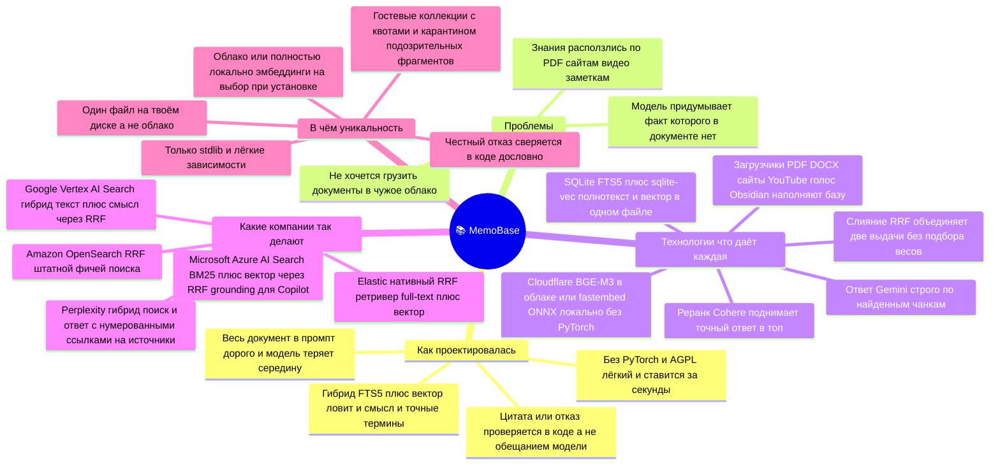

# Mind-map: MemoBase

Как проектировался плагин, какие проблемы решает, на чём построен, **какие компании идут
тем же путём** и в чём отличие — одной картой. Рендерится прямо на GitHub (mermaid).
Презентационная версия той же карты — в Excalidraw (исходник для видео и соцсетей):
[`docs/MINDMAPS.excalidraw`](MINDMAPS.excalidraw) — открыть на [excalidraw.com](https://excalidraw.com)
(File → Open), оттуда экспорт в PNG/SVG. Рисованный «карандашный» стиль. Под блоком карточек —
полоса **«🛠 Что даёт каждая технология и как её поставить»** (роль + команда установки, см. таблицу
ниже), а ещё ниже — стикер «Как питчить за 30 секунд» (проблема → решение → как → отстройка → крючок).

## 📚 MemoBase — база знаний

**🛠 Стек и установка MemoBase** — `install.sh` / `install.ps1` **одной командой**: копируют плагин
на место, ставят зависимости и включают `memobase` в `config.yaml` (руками конфиг не трогаешь):

| Технология | Что даёт | Как поставить |
|---|---|---|
| **install.sh / install.ps1** | копирует плагин, ставит зависимости, включает `memobase` в `config.yaml` | `./install.sh` (Linux/macOS) или `.\install.ps1` (Windows) — одна команда |
| **SQLite FTS5** | полнотекст (BM25) в том же файле базы | в stdlib Python — ставить не надо |
| **sqlite-vec** | векторный KNN прямо внутри SQLite | ставится автоматически базовым install |
| **Cloudflare BGE-M3** | эмбеддинги 1024-dim в облаке, без GPU | ключи `CLOUDFLARE_ACCOUNT_ID` + `CLOUDFLARE_API_TOKEN` в `.env` |
| **fastembed / ONNX** | те же эмбеддинги офлайн, без PyTorch | `install.sh --local` (`-Local`) — качает e5-large ~2.2 ГБ |
| **RRF-слияние** | объединяет FTS+вектор без подбора весов | свой код (`retrieve.py`) — зависимостей нет |
| **Cohere Rerank** | поднимает точный ответ в топ выдачи | ключ `COHERE_API_KEY` в `.env` (опц.; иначе rrf-only) |
| **Загрузчики** (pdfplumber, mammoth, trafilatura, Groq/Gemini STT) | наполнение базы: PDF · DOCX · сайты · YouTube · голос · Obsidian | тот же install + ключи STT в `.env` + `ffmpeg` в системе |
| **Gemini** | генерация ответа строго по найденному | ключ `GEMINI_API_KEY` в `.env` |

> Цвет-код презентационной карты: как проектировалась · проблемы · технологии · какие компании так делают · уникальность.
> Источники по компаниям (проверено): Azure AI Search (RRF в hybrid ranking), Elasticsearch RRF-retriever,
> Google Vertex AI Search (RRF), Amazon OpenSearch (RRF в Neural Search), Perplexity (Vespa + цитаты).
